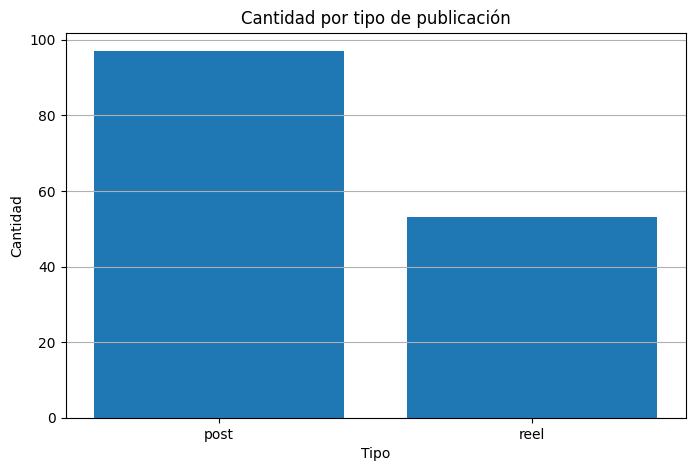

# IMOVEQROO | Facebook Publications and Engagement Analytics

### Social Media Data Engineering, Exploratory Data Analysis, and Institutional Communication Metrics Using Python



*Figure: Distribution of Facebook posts and reels, generated from the notebook's saved analysis.*

**Project Type:** Applied Data Engineering and Social Media Analytics  
**Field:** Data Engineering | Exploratory Data Analysis | Digital Communication Analytics  
**Programming Language:** Python  
**Environment:** Google Colab | Jupyter Notebook  
**Author:** Data Engineer Luis Barahona

---

## 1. Project Overview

This project explores the use of Python for processing and analyzing Facebook publication data associated with IMOVEQROO (Instituto de Movilidad del Estado de Quintana Roo), a public transportation and mobility institution in Mexico.

The notebook develops an exploratory data engineering workflow for transforming social media records from JSON into structured analytical datasets.

The project focuses on organizing publication information, classifying content by URL type, measuring recorded interactions, and producing visualizations and exportable reports.

The analysis includes:

- JSON data ingestion.
- Data cleaning and standardization.
- Duplicate URL detection.
- Publication classification.
- Likes, shares, and comments analysis.
- Engagement distribution visualizations.
- Top-performing publication rankings.
- CSV and Excel exports.

The project demonstrates how data engineering and exploratory analytics can support the study of institutional communication on social media.

---

## 2. Project Objectives

The main objectives are to:

1. Import Facebook publication records from JSON.
2. Identify the relevant fields for social media analysis.
3. Clean text and normalize publication URLs.
4. Remove duplicate publication links.
5. Classify publications into content types.
6. Convert interaction fields into numerical variables.
7. Calculate descriptive statistics.
8. Visualize interaction distributions.
9. Identify publications with the highest recorded engagement.
10. Generate structured datasets for further analysis.

---

## 3. Dataset Description

The notebook processes a JSON dataset containing 150 Facebook publication records.

### Original Data Fields

The initial JSON inspection identifies the following fields:

```text
media
url
text
likes
shares
```

The processing workflow also checks for a `comments` field.

If a field is unavailable, the corresponding column is initialized with a default value.

### Analytical Dataset

The final structured dataset includes:

| Variable | Description |
|:---|:---|
| url | Facebook publication URL |
| texto | Original publication text |
| texto_limpio | Cleaned publication text |
| likes | Original likes field |
| shares | Original shares field |
| comments | Original comments field or default |
| likes_num | Numeric likes count |
| shares_num | Numeric shares count |
| comments_num | Numeric comments count |
| tipo | Publication category |

### Data Source

The notebook uses a previously collected Facebook publication JSON export.

The data collection procedure itself is not implemented in this notebook.

Consequently, the project focuses on processing and analyzing existing records rather than performing live Facebook data extraction.

---

## 4. Data Engineering Workflow

### Step 1 — Import Dependencies

The notebook uses Python libraries for data manipulation, numerical analysis, and visualization.

```python
import pandas as pd
import matplotlib.pyplot as plt
import json
import re
from google.colab import files
```

### Step 2 — Upload JSON Data

The dataset is uploaded through the Google Colab interface.

```python
uploaded = files.upload()
```

The selected file is loaded using the JSON library.

### Step 3 — Inspect the Dataset

The notebook examines:

- JSON structure.
- Number of records.
- Available fields.
- Sample observations.

The saved execution identifies 150 records in the uploaded JSON file.

### Step 4 — Create a Structured DataFrame

The workflow selects the fields needed for analysis:

- Publication URL.
- Text content.
- Likes.
- Shares.
- Comments.

A Pandas DataFrame is constructed to organize the observations.

### Step 5 — Clean Publication URLs

The data cleaning procedure:

1. Removes rows without a valid URL.
2. Normalizes URL strings.
3. Keeps records containing `facebook.com`.
4. Removes duplicate URLs.
5. Resets the DataFrame index.

The saved execution retains 150 publication records after this filtering stage.

### Step 6 — Normalize Text

The notebook defines a text cleaning function:

```python
def limpiar_texto(txt):
    if pd.isna(txt):
        return ""

    txt = str(txt)
    txt = re.sub(r"http\S+", "", txt)
    txt = re.sub(r"\s+", " ", txt)

    return txt.strip()
```

This removes embedded URLs and extra whitespace from the textual content.

### Step 7 — Convert Interaction Metrics

The interaction fields are converted to numerical values.

```python
base["likes_num"] = pd.to_numeric(
    base["likes"], errors="coerce"
).fillna(0)

base["shares_num"] = pd.to_numeric(
    base["shares"], errors="coerce"
).fillna(0)

base["comments_num"] = pd.to_numeric(
    base["comments"], errors="coerce"
).fillna(0)
```

Invalid or missing values are replaced with zero.

This supports consistent numerical analysis, although missing values and genuine zeros become indistinguishable.

---

## 5. Publication Classification

The notebook classifies Facebook publications according to their URL structure.

### Classification Rules

| URL Pattern | Category |
|:---|:---|
| /posts/ | Post |
| /reel/ | Reel |
| /photo/ | Photo |
| /videos/ | Video |
| Other URL patterns | Other |

### Python Implementation

```python
def tipo_publicacion(url):
    url = str(url).lower()

    if "/posts/" in url:
        return "post"
    elif "/reel/" in url:
        return "reel"
    elif "/photo/" in url:
        return "photo"
    elif "/videos/" in url:
        return "video"
    else:
        return "otro"
```

The classification is based on URL patterns rather than direct inspection of the media content.

---

## 6. Experimental Results

The following results are recorded in the notebook's saved execution.

### Publication Distribution

| Content Type | Publications | Percentage |
|:---|---:|---:|
| Posts | 97 | 64.67% |
| Reels | 53 | 35.33% |
| Videos | 0 | 0.00% |
| Photos | 0 | 0.00% |
| **Total** | **150** | **100.00%** |

### Interaction Summary

| Metric | Recorded Total |
|:---|---:|
| Likes | 3,657 |
| Shares | 1,407 |
| Comments | 318 |
| **Total recorded interactions** | **5,382** |

These figures represent the interaction fields available in the processed dataset.

They do not measure unique users, impressions, reach, or audience size.

### Average Interactions per Publication

| Metric | Mean |
|:---|---:|
| Likes | 24.38 |
| Shares | 9.38 |
| Comments | 2.12 |

The averages are calculated across 150 publication records.

### Key Observations

- Posts represent the majority of analyzed records.
- Reels represent approximately one-third of the dataset.
- The notebook identifies notable variation in recorded engagement across publications.
- Some individual publications receive substantially more interactions than others.
- The dataset can support additional research into institutional communication patterns.

The results describe the analyzed sample and should not be generalized to all IMOVEQROO Facebook activity without establishing representative coverage.

---

## 7. Exploratory Data Analysis

The notebook generates several visualizations.

### 7.1 Likes Distribution

A histogram displays the frequency distribution of likes across publications.

This helps examine engagement variability.

### 7.2 Shares Distribution

A second histogram examines how frequently publications are shared.

### 7.3 Comments Distribution

A third histogram displays recorded comment counts.

### 7.4 Publication Types

A bar chart compares the number of posts and reels in the dataset.


*Figure: Publication categories identified through Facebook URL classification.*

### 7.5 Top Publications by Likes

The notebook sorts publications by their recorded likes and selects the ten highest-ranking entries.

The resulting table includes:

- Publication type.
- Publication URL.
- Likes.
- Shares.
- Comments.
- Cleaned publication text.

### 7.6 Top Publications by Comments

A separate ranking identifies the ten publications with the highest recorded comment counts.

These rankings support exploratory comparison of publication-level interactions.

---

## 8. Exported Files

The notebook produces three exportable files.

### 8.1 Cleaned Publication Dataset

```text
imoveqroo_posts_limpio.csv
```

Contains the cleaned analytical dataset.

### 8.2 Publication URLs

```text
imoveqroo_urls_posts.csv
```

Contains the list of unique publication URLs.

### 8.3 Excel Summary

```text
imoveqroo_resumen_posts.xlsx
```

The Excel workbook contains four worksheets:

| Worksheet | Content |
|:---|:---|
| Base limpia | Cleaned publication records |
| Solo URLs | Unique Facebook URLs |
| Top likes | Ten publications with the highest likes |
| Top comentarios | Ten publications with the highest comments |

These exports enable subsequent analysis with spreadsheet tools or Python.

---

## 9. Technologies Used

| Technology | Purpose |
|:---|:---|
| Python | Programming language |
| Pandas | Structured data processing |
| JSON | Source data format |
| Regular Expressions | Text normalization |
| Matplotlib | Statistical visualization |
| OpenPyXL | Excel workbook export |
| CSV | Structured data export |
| Google Colab | Cloud notebook execution |
| Jupyter Notebook | Interactive analytics environment |

---

## 10. How to Run

### Google Colab

[Open the IMOVEQROO Facebook Analytics Notebook](https://colab.research.google.com/drive/1hblOo5GEWy7IvsViwwomFIggZkuMFEBp)

### Requirements

- Python 3
- Pandas
- Matplotlib
- OpenPyXL
- Google Colab
- A compatible Facebook publication JSON dataset

### Install Dependencies

```bash
pip install pandas matplotlib openpyxl
```

### Execution Instructions

1. Open the notebook in Google Colab.
2. Install the required libraries.
3. Upload a compatible JSON dataset.
4. Convert the JSON records into a Pandas DataFrame.
5. Create the structured analytical dataset.
6. Clean publication URLs and text.
7. Convert engagement fields to numeric values.
8. Classify publication types.
9. Calculate descriptive statistics.
10. Generate charts and publication rankings.
11. Export the CSV and Excel reports.

### Important Reproducibility Note

The original notebook references a variable named `df` when constructing the `base` DataFrame, but its preceding JSON loading cell does not define that variable.

Before running the complete notebook from a clean environment, initialize the DataFrame after loading the JSON:

```python
df = pd.DataFrame(data)
```

This correction is required for the displayed workflow to execute reliably from the beginning.

---

## 11. Practical Applications

The techniques demonstrated in this notebook may support:

- Institutional digital communication analysis.
- Social media engagement reporting.
- Public-sector communication studies.
- Exploratory citizen interaction analysis.
- Digital content performance monitoring.
- Data extraction and transformation workflows.
- Business Intelligence and reporting.
- Data Engineering education.

---

## 12. Limitations

This project is an exploratory analysis of a specific JSON dataset.

Important limitations include:

### Sample Coverage

The analyzed records may not represent every publication from the institution.

### External Data Collection

The original scraping procedure is not included in the notebook.

### URL-Based Classification

Publication categories are inferred from URL structures.

### Missing Interactions

Missing or invalid numerical values are converted to zero, potentially understating totals.

### No Audience Reach Data

The notebook does not calculate impressions, reach, or engagement rates based on audience exposure.

### No Sentiment Analysis

The project does not perform natural language sentiment classification.

### No Time-Based Trend Analysis

Publication dates are not incorporated into the final analytical model.

### No Official Institutional Endorsement

The notebook is an independent analytical exercise involving publicly associated institutional communication data.

It does not imply official endorsement or authorization by IMOVEQROO.

---

## 13. Future Improvements

Potential developments include:

- Incorporating publication timestamps.
- Measuring engagement trends over time.
- Comparing performance across content categories.
- Adding engagement rates when reach or impression data is available.
- Implementing Natural Language Processing.
- Performing topic modeling and sentiment analysis.
- Detecting high-engagement publication patterns.
- Creating an interactive dashboard.
- Automating periodic data ingestion where permitted.
- Adding data quality tests and reproducible pipelines.

---

## 14. Conclusion

This project demonstrates how Python can be used to transform raw social media publication records into structured datasets and exploratory analytical reports.

The notebook processes 150 Facebook publication records associated with IMOVEQROO, identifies 97 posts and 53 reels, and summarizes 5,382 recorded interactions.

Through data cleaning, publication classification, visualization, and structured exports, the project provides a practical example of applying Data Engineering and exploratory analytics to digital institutional communication.

The results also establish a foundation for future research involving audience engagement patterns, institutional communication analytics, and automated reporting.

---

## 15. Project Resources

### Google Colab Notebook

[Open the Original Notebook](https://colab.research.google.com/drive/1hblOo5GEWy7IvsViwwomFIggZkuMFEBp)

### Pandas Documentation

[Pandas — Python Data Analysis Library](https://pandas.pydata.org/docs/)

### Matplotlib Documentation

[Matplotlib — Data Visualization](https://matplotlib.org/stable/)

---

## Author

**Data Engineer Luis Barahona**

Mexican Data Engineer and 2026 graduate of Universidad del Caribe, interested in Data Engineering, Data Science, Artificial Intelligence, Social Media Analytics, and technology applied to real-world challenges.

---

## Contact

| Platform | Contact |
|:---|:---|
| Email | [190300395@ucaribe.edu.mx](mailto:190300395@ucaribe.edu.mx) |
| GitHub | [github.com/LuisBarahonaMX](https://github.com/LuisBarahonaMX) |
| LinkedIn | [linkedin.com/in/luis-barahona-mx](https://www.linkedin.com/in/luis-barahona-mx/) |
| Instagram | [@luisbarahonamx](https://www.instagram.com/luisbarahonamx/) |
| X | [@luisbarahonaMX](https://x.com/luisbarahonaMX) |
| Website | [SIKO AI Platform](https://sikoai.web.app/) |
